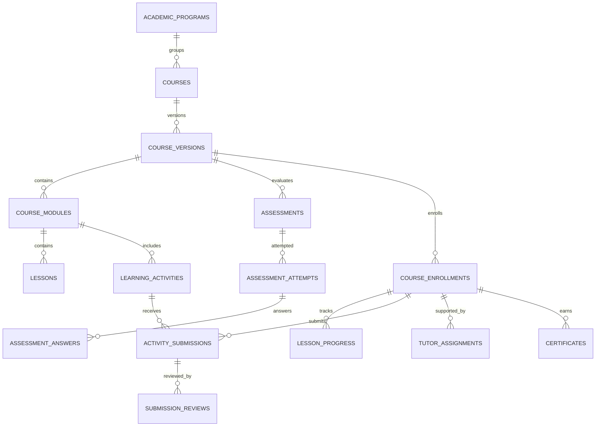

# Arquitectura del núcleo académico

> Estado: propuesta funcional y de dominio para revisión. No crea tablas, funciones, políticas, migraciones ni componentes ejecutables. No modifica Supabase ni datos de producción.

- Producto: Academia DECOM.
- Primera puesta en marcha: Distrito 34.
- Arquitectura objetivo: varios distritos sin duplicar cursos ni mezclar datos académicos.
- Dependencia documental: auditoría inicial de línea base de Supabase.
- Fecha: 2026-11-11.

## 1. Objetivos y principios

1. Ofrecer una ruta formativa secuencial, autogestionada y medible.
2. Separar el catálogo académico institucional de las inscripciones y resultados de cada estudiante.
3. Permitir cursos, módulos, lecciones, actividades prácticas, evaluaciones, tutorías y certificados.
4. Mantener evidencia verificable de cada intento, entrega, revisión y cambio de estado.
5. Aplicar autorización en servidor y base de datos por rol y ámbito; ocultar un botón nunca será un control de seguridad.
6. Permitir que un curso publicado conserve su contenido y reglas mientras se crean nuevas versiones.
7. No bloquear el aprendizaje por fallos de correo, notificaciones o servicios auxiliares.
8. Construir primero una instalación aislada y pruebas de autorización; no aplicar este diseño directamente a producción.

## 2. Lenguaje del dominio

| Concepto | Responsabilidad |
|---|---|
| Programa | Agrupa una ruta de formación (por ejemplo, Formación DECOM). |
| Curso | Unidad formativa con objetivos, requisitos y criterios de aprobación. |
| Versión del curso | Fotografía inmutable de los contenidos y reglas que se publicaron juntos. |
| Módulo | Agrupa lecciones y actividades dentro de una versión de curso. |
| Lección | Contenido de aprendizaje: texto, video, audio, documento, enlace o recurso mixto. |
| Actividad | Evidencia práctica que el estudiante debe entregar. |
| Evaluación | Prueba calificable basada en un conjunto de preguntas y reglas de intento. |
| Banco de preguntas | Preguntas reutilizables, versionadas y clasificadas por tema y dificultad. |
| Inscripción | Relación de un estudiante con una versión concreta del curso. |
| Entrega | Envío inmutable de una actividad por parte del estudiante. |
| Revisión | Evaluación de una entrega por un tutor, con rúbrica y retroalimentación. |
| Intento | Ejecución individual de una evaluación, con preguntas y respuestas congeladas. |
| Asignación tutorial | Relación entre tutor, estudiante/inscripción y ámbito de acompañamiento. |
| Progreso | Estado calculado a partir de lecciones, actividades y evaluaciones completadas. |
| Reconocimiento | Logro institucional concedido por una regla verificable. |
| Certificado | Acreditación emitida para una inscripción que cumple los requisitos. |

## 3. Modelo lógico propuesto

Los nombres son conceptuales; no constituyen nombres SQL definitivos.

### 3.1 Catálogo académico

- `academic_programs`: nombre, descripción, estado y orden de presentación.
- `courses`: programa, código único, título, descripción, nivel, imagen, duración estimada y estado editorial.
- `course_versions`: curso, número de versión, estado (`draft`, `published`, `retired`), objetivos, reglas de aprobación, fecha de publicación y autor.
- `course_prerequisites`: versión/curso requerido y regla de cumplimiento.
- `course_modules`: versión de curso, título, descripción y posición.
- `lessons`: módulo, título, tipo de contenido, contenido estructurado, duración estimada, posición y obligatoriedad.
- `lesson_resources`: recursos adjuntos con metadatos y referencia privada a Storage.
- `learning_activities`: módulo o lección, instrucciones, tipo de entrega, fecha límite opcional, rúbrica y política de reenvío.
- `assessments`: versión de curso o módulo, instrucciones, umbral, duración, intentos permitidos, aleatorización y publicación.
- `question_banks`, `questions`, `question_options`: clasificación y contenido versionado de preguntas.
- `assessment_question_rules`: cantidad de preguntas a seleccionar por tema/dificultad y puntuación.
- `grading_rubrics`, `grading_criteria`: criterios y escalas para evaluación objetiva o manual.

### 3.2 Inscripción y ejecución

- `course_enrollments`: estudiante, versión publicada, distrito, congregación de referencia, estado, fecha de inicio y finalización.
- `lesson_progress`: inscripción, lección, estado, primera apertura y fecha de finalización.
- `activity_submissions`: actividad, inscripción, número de versión de entrega, texto/archivo, fecha y estado.
- `submission_reviews`: entrega, tutor revisor, calificación, observaciones, rúbrica aplicada y decisión.
- `assessment_attempts`: evaluación, inscripción, secuencia del intento, inicio, envío, puntuación y resultado.
- `assessment_attempt_items`: instantánea de pregunta, opciones y orden asignados a un intento.
- `assessment_answers`: respuesta enviada y puntuación obtenida por pregunta.
- `tutor_assignments`: tutor, estudiante o inscripción, distrito, vigencia, estado y responsable que asignó.
- `tutor_notes`: nota privada de seguimiento, autor, inscripción y visibilidad.
- `enrollment_events`: historial auditable de cambios de estado y decisiones relevantes.

### 3.3 Reconocimiento y certificación

- `achievement_definitions`: insignias/logros, condición, XP, vigencia y visibilidad.
- `achievement_awards`: logro concedido, usuario, evidencia, fecha y clave de idempotencia.
- `xp_ledger`: movimientos positivos/negativos de XP con causa, referencia y clave idempotente; el saldo se deriva.
- `certificates`: inscripción, versión de plantilla, código público aleatorio, hash/identificador de verificación, fecha de emisión y estado.
- `certificate_events`: emisión, revocación, reemisión y motivo.
- La verificación pública solo debe revelar autenticidad, nombre visible autorizado, curso, fecha y estado; nunca correo, teléfono, notas ni información interna.

### 3.4 Relaciones principales

## 4. Reglas académicas

### 4.1 Ruta y secuencia

- El primer curso obligatorio será **Identidad corporativa DECOM**.
- Los cursos siguientes se habilitan cuando se cumplen los requisitos explícitos del curso anterior.
- Dentro de cada versión, módulos y lecciones tienen orden estable.
- Una lección obligatoria debe marcarse completada antes de habilitar el siguiente hito obligatorio.
- Una actividad puede bloquear el avance si está marcada como requisito; las actividades complementarias no bloquean.
- Los cursos pueden incluir contenido de medios escritos, radio, medios digitales, audiovisuales y niveles avanzados de fotografía, video, imagen, audio e IA.
- No se deben codificar nombres de cursos o rutas directamente en lógica de aplicación: la secuencia se administra en el catálogo.

### 4.2 Publicación y versionado

- El contenido en borrador es editable por editores autorizados.
- Publicar valida que el curso tenga objetivos, módulos, contenido, criterios de aprobación y evaluaciones requeridas.
- Una versión publicada no se modifica en el sitio. Una corrección crea una nueva versión.
- Las inscripciones existentes conservan su versión original para que una actualización editorial no cambie retroactivamente notas, preguntas ni requisitos.
- Una política explícita podrá ofrecer migración voluntaria a una nueva versión, registrando quién la autorizó y cuándo.
- Archivar una versión impide nuevas inscripciones, pero no elimina el historial ni los certificados emitidos.

### 4.3 Actividades y tutoría

- Las actividades aceptan tipos configurables: texto, archivo, enlace, cuestionario práctico o combinación.
- Cada reenvío crea una nueva entrega; no sobrescribe la evidencia anterior.
- El estudiante ve el estado, fecha, retroalimentación y rúbrica publicada para él.
- Los tutores solo revisan estudiantes e inscripciones que tengan asignados dentro de su ámbito vigente.
- Una revisión registra tutor, fecha, calificación, criterios, observaciones y decisión (`approved`, `changes_requested`, `rejected`).
- El estudiante puede reenviar cuando la actividad y la decisión lo permitan.
- Los cambios de tutor no borran las revisiones previas.

### 4.4 Evaluaciones y banco de preguntas

- Tipos iniciales: selección única, selección múltiple, verdadero/falso, emparejamiento, ordenamiento y respuesta abierta.
- La selección aleatoria ocurre al iniciar el intento, no al renderizar cada pregunta.
- Se guarda una instantánea del texto, opciones, orden y puntuación de cada pregunta servida para evitar que ediciones posteriores alteren un intento histórico.
- La respuesta correcta y la explicación no se envían al navegador antes de entregar el intento.
- El servidor controla duración, cantidad máxima de intentos, apertura/cierre, elegibilidad y calificación.
- Las preguntas objetivas se califican automáticamente; las abiertas pueden requerir revisión humana.
- Las reglas de selección por tema y dificultad deben impedir exámenes incompletos cuando el banco no tenga suficientes preguntas publicadas.
- Los intentos enviados son inmutables; una corrección administrativa debe quedar como evento separado y auditable.

### 4.5 Aprobación, avance y certificado

- La inscripción termina cuando se cumplen todos los requisitos obligatorios de la versión: lecciones, actividades aprobadas y evaluaciones con puntuación mínima.
- El progreso porcentual se calcula desde requisitos completados, no desde visitas ni aperturas.
- El servidor es la autoridad para marcar hitos, aprobar cursos y emitir certificados.
- La emisión es idempotente: una inscripción no debe generar certificados duplicados por doble clic, reintento o ejecución concurrente.
- Revocar un certificado requiere permiso explícito y motivo; la URL de verificación debe mostrarlo como revocado.
- Los reconocimientos y XP se generan a partir de eventos confirmados, con claves idempotentes para evitar duplicados.

## 5. Estados propuestos

| Entidad | Estados |
|---|---|
| Curso | `draft`, `published`, `archived` |
| Versión | `draft`, `published`, `retired` |
| Inscripción | `enrolled`, `in_progress`, `completed`, `withdrawn`, `suspended` |
| Lección | `not_started`, `in_progress`, `completed`, `blocked` |
| Entrega | `submitted`, `under_review`, `approved`, `changes_requested`, `rejected` |
| Intento | `in_progress`, `submitted`, `graded`, `voided` |
| Certificado | `issued`, `revoked`, `superseded` |
| Asignación tutorial | `active`, `ended`, `revoked` |

Los estados se validarán en la capa de dominio y en restricciones de base de datos cuando se implemente el esquema.

## 6. Autorización y ámbitos

Los permisos se aplican por operación y ámbito (global, distrito, congregación, inscripción asignada), no solo por nombre de rol.

| Rol existente | Capacidades académicas previstas |
|---|---|
| `national_admin` | Administración global, asignación de permisos y supervisión de todos los distritos. |
| `district_coordinator` | Seguimiento y reportes de su distrito; gestión operativa de participantes dentro del ámbito autorizado. |
| `area_coordinator` (comité distrital) | Consulta y seguimiento académico del distrito según los permisos acordados para el comité; no obtiene edición de contenido global por ser coordinador de área. |
| `academic_editor` | Crear y editar programas, cursos, versiones, módulos, lecciones, preguntas y rúbricas; publicar solo si recibe permiso de publicación. |
| `tutor` | Consultar el contenido necesario y revisar entregas de estudiantes asignados; sin modificar notas o entregas de otros tutores. |
| `local_responsible` | Consultar avance de participantes de su congregación; no ver respuestas, archivos privados ni retroalimentación confidencial salvo autorización expresa. |
| `member` | Acceder a su formación, contenido publicado, actividades, evaluaciones, progreso, logros y certificados. |

Reglas de seguridad obligatorias:

1. Resolver la identidad con la sesión autenticada del servidor; no aceptar un `user_id`, rol, distrito o congregación enviado por el cliente como prueba de autorización.
2. Comprobar el ámbito vigente mediante las asignaciones existentes y funciones de autorización probadas; un rol global no debe confundirse con una asignación distrital.
3. Para cada tabla expuesta, habilitar RLS y definir políticas específicas de SELECT/INSERT/UPDATE/DELETE. No crear una política genérica `authenticated` sin predicado de ámbito.
4. La exposición a la Data API es independiente de RLS. Desde el cambio de Supabase aplicado a todos los proyectos el 30 de octubre de 2026, las tablas nuevas del esquema `public` no se exponen automáticamente; cada tabla debe tener una decisión explícita de exposición y grants mínimos, además de RLS. No asumir que crear la tabla la hace accesible por REST.
5. Para UPDATE, validar tanto la fila original (`USING`) como los valores resultantes (`WITH CHECK`).
6. Mantener las tablas de entregas, intentos, respuestas, revisiones, notas, eventos y certificados privadas por defecto; exponer solo vistas/consultas mínimas con autorización comprobada.
7. Las funciones privilegiadas deben estar en un esquema no expuesto, con `search_path` seguro, validación de identidad y privilegios EXECUTE mínimos. No añadir `SECURITY DEFINER` como solución genérica a errores RLS.
8. Los archivos de estudiantes deben almacenarse en buckets privados, con rutas no predecibles y políticas de Storage que comprueben inscripción y asignación tutorial.
9. No confiar en metadatos editables por el usuario para autorizar roles.
10. Las operaciones de calificación, aprobación, XP y certificado deben ejecutarse en servidor y dejar trazabilidad.
11. Los reportes distritales deben agregar datos sin exponer detalles personales que el rol no necesita.

### Matriz de acciones de alto nivel

| Acción | Estudiante | Tutor asignado | Editor académico | Coordinación distrital/comité | Admin nacional |
|---|---:|---:|---:|---:|---:|
| Ver su propio progreso | Sí | Sí, asignados | No por defecto | Sí, agregado/ámbito | Sí |
| Consumir curso publicado | Sí | Sí | Sí | Sí | Sí |
| Editar contenido académico | No | No | Sí | No | Sí |
| Publicar versión | No | No | Solo con permiso | No | Sí |
| Entregar actividad | Sí, propia | No | No | No | No |
| Revisar entrega | No | Sí, asignados | No por defecto | No por defecto | Excepción auditada |
| Ver respuestas detalladas | Propias según política | Asignados si necesario | No por defecto | No por defecto | Excepción auditada |
| Emitir/revocar certificado | No | No | No | No | Sí; operación auditada |

La coordinación distrital y el comité podrán consultar indicadores de avance y alertas de acompañamiento del distrito. El acceso a contenido sensible de entregas o respuestas requiere un permiso separado, no implícito en la consulta de reportes.

## 7. Flujos principales

### 7.1 Diseño y publicación

1. Editor crea un curso en borrador.
2. Define objetivos, prerrequisitos, módulos, lecciones, actividades, evaluaciones y rúbricas.
3. Configura el banco y las reglas de selección del examen.
4. El sistema valida integridad y cobertura de preguntas.
5. Un publicador autorizado revisa y publica una versión.
6. La versión publicada queda congelada y disponible para nuevas inscripciones autorizadas.

### 7.2 Inscripción y aprendizaje

1. El estudiante autenticado solicita o recibe inscripción a una versión publicada.
2. El servidor determina distrito y congregación desde las asignaciones vigentes; el cliente no puede escoger un ámbito ajeno.
3. Se comprueban prerrequisitos y duplicidad de inscripción activa.
4. Se crea inscripción y progreso inicial.
5. El estudiante avanza por lecciones y entrega las actividades requeridas.
6. Los hitos se registran de forma transaccional e idempotente.

### 7.3 Revisión tutorial

1. El sistema asigna tutor dentro del ámbito permitido.
2. La entrega queda en cola de revisión.
3. El tutor asignado revisa con la rúbrica de la versión vigente.
4. La decisión se registra sin sobrescribir la entrega.
5. El estudiante recibe notificación y, si corresponde, puede reenviar.
6. Los cambios de estado y tutor quedan en historial auditable.

### 7.4 Evaluación

1. El servidor verifica inscripción, requisitos previos, ventana de disponibilidad e intentos restantes.
2. Crea un intento y selecciona preguntas según las reglas configuradas.
3. Guarda la instantánea de preguntas y opciones servidas.
4. El estudiante responde y entrega.
5. El servidor calcula el resultado objetivo y deriva preguntas abiertas a revisión.
6. El intento se cierra y el resultado se incorpora al progreso.

### 7.5 Cierre y certificación

1. El servidor recalcula todos los requisitos de la versión.
2. Si se cumplen, cambia la inscripción a completada.
3. Una operación idempotente emite certificado y reconocimiento aplicable.
4. Se registra el evento de emisión y se genera un código público aleatorio para verificación.
5. La consulta pública no revela información privada ni permite enumerar certificados.

## 8. Reglas de integridad y concurrencia

- Una inscripción activa única por estudiante y versión de curso, salvo que el diseño de negocio autorice explícitamente cohortes repetibles.
- Un único intento activo por estudiante/evaluación/inscripción, salvo evaluaciones con concurrencia permitida.
- Restricciones únicas para número de intento, código de certificado y claves idempotentes.
- Entregas y respuestas enviadas no se actualizan destructivamente; las correcciones se registran como nuevos eventos o revisiones.
- Las operaciones que cambian estado y generan XP/certificado deben ser atómicas o coordinarse mediante una cola transaccional.
- Bloquear o serializar la creación de intentos para impedir que dos solicitudes simultáneas excedan el máximo.
- Guardar marcas de tiempo en UTC y presentar en zona horaria local.
- Definir política de retención, eliminación y anonimización antes de almacenar datos de menores o documentos sensibles; la fecha de nacimiento existente requiere minimización de uso.
- Registrar actor, ámbito, entidad, acción, motivo y fecha en eventos administrativos.

## 9. Arquitectura de aplicación Next.js

- Mantener componentes de interfaz en `app/dashboard` y extraer lógica de dominio a módulos `lib/academic`.
- Usar Server Components para lecturas iniciales protegidas cuando sea posible.
- Usar Server Actions o Route Handlers para comandos que necesiten validación de servidor, límites de carga o claves secretas.
- Centralizar esquemas de validación y tipos de dominio; no duplicar reglas críticas en múltiples páginas.
- El cliente puede mostrar progreso y validaciones de experiencia, pero el servidor vuelve a validar cada transición.
- Separar servicios: catálogo, inscripción, progreso, entregas, evaluación, tutoría, certificación y reportes.
- Usar Storage privado para evidencias; entregar URLs firmadas de corta duración tras autorizar la inscripción.
- Las notificaciones son efectos secundarios posteriores a una transacción confirmada y deben ser idempotentes.

## 10. Diseño del panel del estudiante

La navegación de estudiante debe priorizar:

1. **Continuar formación:** curso actual, módulo/lección pendiente y botón de continuar.
2. **Mi ruta:** cursos obligatorios, prerrequisitos y estados bloqueado/en curso/completado.
3. **Actividades:** pendientes, en revisión, cambios solicitados y aprobadas.
4. **Evaluaciones:** disponibles, intentos realizados, resultados y próximas pruebas.
5. **Tutoría:** tutor asignado, retroalimentación y solicitudes de acompañamiento.
6. **Mi progreso:** porcentaje por curso y módulo, horas estimadas, hitos y fechas.
7. **Reconocimientos:** XP, insignias y logros con su evidencia.
8. **Certificados:** certificados emitidos y acceso a verificación.

El panel debe tener estados de carga, vacío, error, bloqueado y completado. No presentar porcentajes ficticios: si no hay inscripción, mostrar la invitación a iniciar la ruta.

## 11. Reportes y métricas

Métricas iniciales:
- Inscritos activos por curso, congregación y distrito.
- Tasa de inicio, finalización y abandono.
- Progreso por módulo y lección obligatoria.
- Actividades pendientes de revisión y antigüedad de la cola.
- Tiempo de revisión por tutor.
- Intentos, aprobación y distribución de puntuaciones.
- Estudiantes que requieren acompañamiento.
- Certificados emitidos y revocados.

Los reportes deben definir denominadores, periodos y filtros. No comparar tutores sin volumen mínimo y contexto. El comité distrital recibe por defecto indicadores agregados; el acceso a detalle individual exige un motivo operativo y permiso específico.

## 12. Fases de implementación

| Fase | Alcance | Criterio de salida |
|---|---|---|
| 0. Fundamento | Cerrar auditoría de esquema, baseline aislada, matriz de permisos y modelo de amenazas. | Reconstrucción aislada verificable; sin drift inexplicado. |
| 1. Catálogo | Programas, cursos, versiones, módulos, lecciones y biblioteca de recursos. | Editor puede preparar y publicar una versión validada. |
| 2. Ruta del estudiante | Inscripción, secuencia, desbloqueo, progreso y panel del estudiante. | Estudiante del Distrito 34 completa el flujo básico. |
| 3. Actividades y tutoría | Entregas versionadas, asignaciones, rúbricas, revisiones y retroalimentación. | Tutor solo puede revisar asignaciones propias. |
| 4. Evaluaciones | Banco, selección aleatoria, intentos, calificación y resultados. | Pruebas de seguridad y concurrencia aprobadas. |
| 5. Reconocimientos | XP, insignias, certificados QR y verificación pública. | Emisión idempotente y revocación auditada. |
| 6. Reportes | Paneles de seguimiento y métricas por ámbito. | Pruebas RLS demuestran aislamiento entre distritos. |
| 7. Escalamiento | Habilitar distritos adicionales y operación institucional. | Pruebas mult distrito, capacidad, respaldo y recuperación. |

## 13. Pruebas de aceptación mínimas

### Funcionales
- Un estudiante nuevo solo ve cursos publicados y habilitados.
- El primer curso obligatorio aparece como Identidad corporativa DECOM.
- No puede saltar una lección o actividad que sea requisito.
- Una nueva versión del curso no cambia inscripciones ni intentos históricos.
- Un reenvío conserva la entrega anterior.
- Un tutor asignado puede revisar; un tutor no asignado no puede consultar ni revisar esa entrega.
- El examen conserva las preguntas servidas aunque el banco se edite después.
- Una doble solicitud de finalización no duplica XP ni certificado.
- La revocación se refleja en la consulta pública del QR.

### Seguridad
- Un estudiante no puede leer ni modificar inscripciones ajenas cambiando UUID.
- Un usuario de otro distrito no puede consultar registros detallados.
- Un coordinador no obtiene permisos de editor ni tutor por su rol distrital.
- Un editor no puede alterar calificaciones ni acceder a datos privados de estudiantes sin permiso.
- Un tutor no puede autoasignarse ni revisar fuera de su asignación.
- Los archivos no son accesibles por URL pública permanente.
- No se confía en datos de rol/distrito enviados por el navegador.
- Las funciones privilegiadas no quedan ejecutables por `PUBLIC` o `anon` por defecto.

### Operación
- Los errores de correo no revierten entregas, calificaciones ni certificados confirmados.
- Hay trazabilidad de cambios de tutor, notas, calificaciones, publicación y certificados.
- La base de datos de pruebas puede reconstruirse desde cero con migraciones revisadas.
- CI ejecuta typecheck, lint, pruebas de dominio, pruebas RLS y compilación.

## 14. Decisiones pendientes antes de implementar

1. ¿La inscripción será automática para todos los miembros activos o requerirá que el estudiante se inscriba?
2. ¿El tutor será asignado por distrito, congregación o individualmente por estudiante/curso?
3. ¿Cuántas oportunidades de reenvío tendrá cada actividad por defecto?
4. ¿Las evaluaciones tendrán un tiempo límite por defecto y una política de recuperación?
5. ¿El certificado se emitirá por curso y también por ruta completa?
6. ¿El comité distrital podrá consultar detalle individual de progreso o solo reportes agregados y alertas?
7. ¿Se permitirá que un estudiante conserve una versión anterior al publicarse una nueva?

Estas decisiones deben resolverse antes de congelar el esquema físico. Los valores por defecto deben configurarse por curso/versión y no quedar incrustados en el código.

## 15. Límites de este entregable

- No se ha creado SQL ni migración.
- No se ha modificado el proyecto Supabase, RLS, roles, Auth, Storage ni datos.
- No se han creado pantallas ni endpoints académicos.
- El modelo físico definitivo depende de cerrar la extracción DDL y reconciliar el historial de migraciones.
- La primera implementación funcional debe probarse en una base aislada y con datos sintéticos del Distrito 34.
